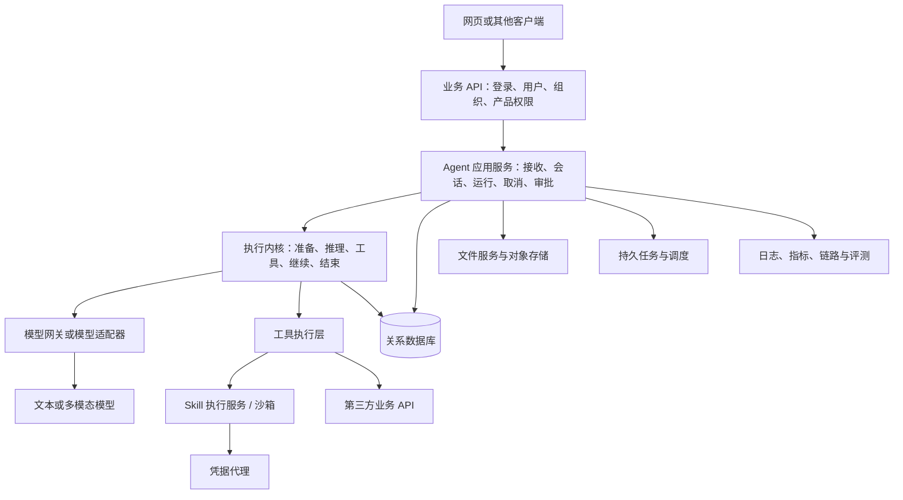

# 02｜整体架构、模块边界与技术选型

## 2.1 先看责任，不先争论语言

一个 Agent 产品可以用 Python、Go、Rust、TypeScript 或组合实现。语言决定生态、部署与并发编程方式的一部分，不决定系统是否是 Agent。把 Python 换成 Rust 不会自动改善事实准确性；把单体拆成微服务也不会自动解决会话一致性。

本章提炼一种已可在成熟服务中观察到的分层模式。这里的组件名称是通用责任，不要求每个框都部署成独立进程。



## 2.2 各层应该知道多少

| 层 | 负责 | 不应该承担 |
|---|---|---|
| 传输层 | HTTP 解析、状态码、SSE 编码、请求大小限制 | 在路由函数里拼所有历史和实现重试 |
| 应用层 | 权限、任务受理、恢复、协调事务边界 | 模型供应商的每种增量格式 |
| 执行内核 | 迭代推进、停止判断、调用能力接口 | JWT 解码、对象存储签名、UI HTML |
| 上下文服务 | 组装模型输入、预算、压缩、来源追踪 | 修改真实历史以迎合模型格式 |
| 工具层 | 参数、执行、结果规范、错误分类 | 凭模型传来的 user_id 决定权限 |
| 持久层 | 查询、索引、原子提交、版本约束 | 选择用户问题该用哪个模型 |
| 模型适配器 | 格式映射、流解析、usage、能力差异 | 业务权限与最终收费政策 |

接口分层的价值不是“多写几层”，而是让每层的变化不扩散。例如换供应商只改适配器及能力配置；新增工具只注册能力与实现；更换前端不改主循环。

## 2.3 用组合根装配依赖

组合根（composition root）就是程序启动时集中构造依赖的地方。它读取经过验证的配置，创建数据库连接池、HTTP 客户端、模型适配器、工具注册表、内存缓存，再传给应用服务。

不要让每个工具随手读取全局环境变量、创建新 HTTP 客户端或重新连接数据库。问题不仅是性能：单测无法替换依赖，不同调用拿到的配置可能不一致，密钥也难以审计。

教学接口：

```text
ModelPort.infer(model_input, controls) -> event_stream
ToolPort.execute(principal, call, controls) -> tool_outcome
ContextPort.prepare(canonical_history, runtime_state) -> model_input
RunStore.commit(expected_owner, items, terminal_state) -> committed | fenced
```

Port 是核心需要的一种能力契约；Adapter 是把具体 SDK/HTTP/数据库接上该契约的实现。不要做一个包含几十个任意回调的万能对象，否则只是把耦合藏起来。

并非每个函数都要抽 trait/interface。一个抽象至少应有实际使用者、可替换需求或明确测试收益。否则模块和具体类型已足够。

## 2.4 业务 API 与 Agent 服务怎么分

一个实用划分是：业务服务管理“谁能使用什么产品”；Agent 服务管理“某次智能任务怎么执行”。两者可共享一个数据库实例，但对表的写入所有权应清楚。

业务 API 向 Agent 服务传可信身份，不能直接信任浏览器提交的用户 ID。服务间认证与最终用户身份是两个维度：前者证明调用方是允许的服务，后者证明这次操作代表谁。仅有内部 API Key 不代表能读取任意用户会话。

Agent 服务可以拥有会话、运行、历史 item、工具调用、摘要、任务状态等传统后端逻辑。这不是架构失败；这些数据天然属于 Agent 的生命周期。如果把状态放业务服务、执行放 Agent 服务，却没有明确协议，反而容易形成两个状态源。

两服务内部采用 HTTP 很常见：控制请求用 JSON，运行事件用 SSE 或内部事件协议。是否使用 gRPC 应由类型约束、服务生态、流处理和维护成本决定，而非“更高级”。

## 2.5 同一个数据库可以，随意互写表不可以

先在一套关系数据库内分 schema 或表前缀，可以降低运维复杂度。把边界写为：

- 哪个模块拥有表及迁移。
- 哪个模块允许写，其他模块通过什么接口获取数据。
- 哪些操作必须在同一事务。
- 跨模块更新失败如何恢复。
- 数据清理时如何处理关联对象。

共享数据库不是永远不能拆库；反而是提前做好所有权后，才有机会平滑拆分。若两个服务长期直接互改对方表，未来改字段需要协调发布，独立服务就名存实亡。

## 2.6 同步、异步与进程边界

“同步接口”通常表示客户端等本次任务结果；“异步 I/O”表示服务在等网络时不占住一个执行线程；“后台任务”表示工作生命周期不依赖当前连接。这三件事可独立组合。

例如：浏览器保持 SSE 连接等待，服务内部异步请求模型，同时把运行状态存库。这不是“每个用户一个线程”。如果工具只有阻塞式 SDK，可用受限阻塞线程池；不要在事件循环工作线程里直接阻塞等待。Rust async 还需要运行时调度与 I/O 驱动，语言语法本身不是网络执行器。概念核验见 [Tokio 教程](https://tokio.rs/tokio/tutorial)。

是否启动子进程取决于工具隔离需要，不取决于是不是 Agent。主循环可长期运行在服务进程内；Python Skill 脚本或不可信代码放子进程/容器/沙箱。主循环服务与脚本执行环境是不同层。

## 2.7 渐进重构：保持行为，逐步抽出内核

参考实现中可以同时存在原有执行引擎与新的中立内核。值得迁移的是责任边界，不是一次性重写全部逻辑。稳健方法：

1. 建立事件、状态、工具结果和持久化契约测试。
2. 在原实现外加薄生命周期入口，入口只委托一次，不复制循环。
3. 把推理、工具、审批、上下文、提交分别暴露为窄能力。
4. 新内核复用已验证的压缩和提交算法。
5. 按可信身份或服务器配置开放新引擎，运行链绑定所选引擎。
6. 比较任务结果、事件顺序、成本、失败恢复；再扩大范围。

“请求出错就偷偷切回旧引擎”看似保险，实际上可能重复工具副作用。回退必须考虑任务是否已执行，不能只看异常类型。灰度配置也不能改变运行到一半的状态机语义。

## 2.8 常见失败与定位

**路由函数越来越长**：从入口找出模型调用、SQL、权限和重试，迁移到各自负责人；先加行为测试再动代码。

**工具能任意拿 AppState**：检查真正需要的能力，给窄上下文。拥有数据库客户端不等于应该拥有所有表的查询能力。

**代码号称“供应商无关”但携带供应商字段到处跑**：把专用签名等作为受控扩展或适配器状态保留，不能丢掉，也不能让业务全依赖它。

**多个模块各维护一份可修改历史**：必须决定哪个是真实历史，哪个是可重建模型视图。不要靠调用顺序“保证应该同步”。

## 2.9 面试与练习

问：为什么用 Rust？  
答：如果团队有该能力，类型约束、内存安全和异步并发有助于长期服务维护；但开发速度、模型生态、调试和跨语言运维也有成本。选型依据是约束与测量，不能声称使用 Rust 就让端到端模型推理快了十倍。

问：怎么保证以后不重构？  
答：不能保证。可保证的是先稳定身份、运行、工具、事件和持久化契约，让变化局限在模块内。好的架构降低修改半径，不消灭变化。

练习：一个工具既检索资料又发邮件，能否与只读检索共用“无需审批”策略？  
解答：不能。应拆出纯读与写动作，或在执行前形成明确动作计划并按实际副作用审查。工具名字叫 search 也不能成为只读证据。方法、路径、授权资源、动作参数和下游语义都可能影响分类。

