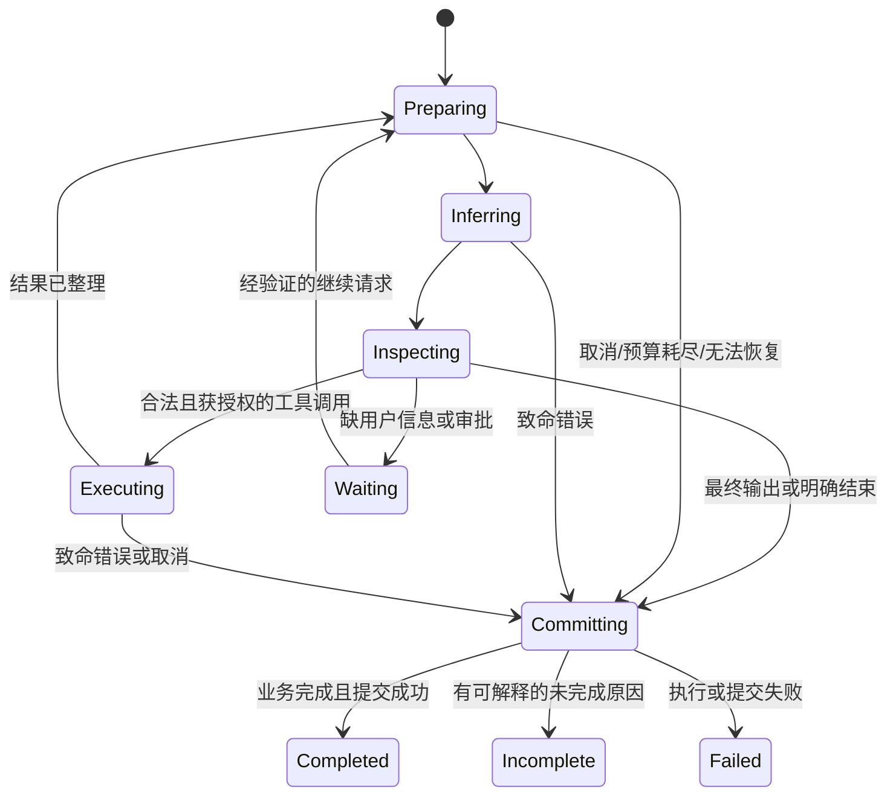

# 04｜Agent Loop：循环、状态机、预算与停止条件

## 4.1 一个循环，两种责任

Agent loop 是服务反复“请求模型→检查输出→执行工具→回填结果”的控制逻辑。模型选择业务下一步；程序决定该选择是否允许执行以及运行怎样结束。ReAct 的核心是把决策与环境反馈交替组织，不是要求向用户展示隐藏思考全文。论文入口见 [ReAct](https://react-lm.github.io/)。

可以把程序状态抽象为：



这是教学状态机。真实服务的 waiting 可能表现为 incomplete 终态加 continuation，而非长时间占住内存。你必须定义它，不必照抄枚举名字。

## 4.2 可落地的循环骨架

下面是伪代码，省略具体协议、数据库与恢复实现：

```python
async def run(ctx, state):
    while True:
        check_ownership_or_stop(ctx)
        if cancelled(ctx):
            return await settle_cancelled(state)
        if budget_exhausted(state):
            return await settle_incomplete(state, "budget_exhausted")

        await apply_pending_user_input_at_safe_boundary(state)
        await compact_if_needed(state)
        model_input = render_model_input(state)

        observation = await infer_with_bounded_retry(model_input, ctx)
        record_observed_usage(observation, state)
        outcome = inspect_model_output(observation)

        if outcome.is_truncated_or_invalid:
            return await settle_incomplete(state, outcome.reason)
        if outcome.requires_tools:
            calls = validate_complete_calls(outcome.calls)
            decision = await authorize_and_classify(calls, ctx.principal)
            if decision.needs_approval:
                return await settle_waiting(state, decision)
            results = await execute_with_limits(decision.allowed_calls)
            append_canonical_call_result_pairs(state, calls, results)
            append_model_facing_results(state, results)
            continue
        if outcome.has_final_content:
            return await commit_final(state, outcome)
        return await settle_failed(state, "empty_model_output")
```

这不是声称所有成熟系统都已覆盖截断等分支，而是推荐的完整设计。参考实现能看到按“准备、推理、输出检查、工具、结算”拆分的结构，也能看到终止原因处理的兼容性风险；读代码不能把已有行为自动当作最佳实践。

## 4.3 不可变运行上下文与可变运行状态

不可变上下文包括可信用户身份、会话和运行 ID、原始请求、允许能力、数据库和模型服务句柄。可变状态包括迭代计数、模型输入、待调用工具、当前输出缓冲、累计 usage、摘要候选、计划进度。

这样的分离让函数签名说明“我需要哪些事实、会改哪些状态”。如果每个函数都同时修改提示词、数据库和 UI 事件，出错时很难知道哪一步已完成。

取消令牌本身可共享并被触发，但它属于控制能力，不是让模型任意改写的字段。对异步调用，应明确在调用前、等待中、结果收尾前分别如何响应取消。

## 4.4 不能只写“没工具就结束”

没有工具调用有至少五种可能：

1. 输出了正常答案。
2. 输出了拒绝，业务上可能是合法结果。
3. 只返回供应商需要回传的推理协议状态，尚无可见答案。
4. 输出空白或协议格式异常。
5. 输出被限制截断，工具参数尚未闭合。

参考模式中可见“有工具→继续执行；有可见文本/拒绝→候选完成；有可回放的模型状态→继续推理；其余→空输出错误”的区分。推荐进一步结合供应商终止原因确认完整性。可见文字不必然完整，HTTP 成功也不必然完成。

状态机的“完成”必须分清：模型一次生成结束、一次工具结束、一次运行结束、用户业务目标完成。这四者经常不同。

## 4.5 五类预算分别防什么

| 预算 | 防止 | 放哪里执行 |
|---|---|---|
| 单次输出 token 上限 | 一次生成无限增长 | 模型请求与返回校验 |
| 单次上下文预算 | 输入与输出挤爆窗口 | 上下文服务 |
| 迭代/工具次数预算 | 循环不收敛 | loop 硬控制 |
| 时间与费用预算 | 工作拖太久或花太多 | 运行控制及执行前检查 |
| 资源并发预算 | 大量任务压垮外部 API | admission、队列、semaphore |

参考实现存在“接近迭代上限时插入收敛提醒，达到上限后由程序停止”的模式。提醒模型优先完成必需验证很有价值，但提醒不等于硬限制。阈值应根据任务分布测量，不应把某个仓库的固定数值当行业标准。

总费用预算不能只在任务结束后检查。高成本工具开始前应估计上界或预留额度，执行后再用实测结算。估计不准时需要安全边际与明确的超额策略。

## 4.6 重试必须有层级

模型请求失败可重试，不代表整轮工具都可以重试；工具失败可以换参数，不代表可以重复写操作。

建议记录 `run_id / iteration / attempt / call_id / external_operation_id`。设模型最多三次尝试只是示例，还需考虑网关、SDK、HTTP 库是否各自重试三次；叠加后可能实际调用二十七次。

普通重试处理短暂不可用；上下文超限要改输入；权限错误要修权限；无效工具参数要形成可理解的错误反馈。它们不是“睡一下再来”一类问题。等待重试的 backoff 也必须可取消。

流中途失败尤其危险：已经发给用户的文本无法像内存缓冲那样撤回。可以明确标记某次 attempt 被放弃、UI 替换该段，或终止并让用户续答；不能在同一条输出后无缝拼第二个不同开头而不说明。

## 4.7 批量工具如何推进

一批工具应明确：可并行组、依赖关系、审批要求和资源限额。批量里存在修改全局路由的控制工具时，可以要求它单独调用，避免“本批后续工具到底由哪个配置执行”的歧义。

每个接受的调用都应有结果或明确终止状态。一个失败时，不应丢掉其他已经成功的调用结果。写操作的失败状态最好区分 rejected、not_started、succeeded、failed、unknown。网络超时之后有可能是 unknown，而不是“确定没发生”。

顺序回填可按原始调用顺序保持稳定；内部完成顺序可以不同。不要因为并行快了一点就牺牲回放确定性和提示缓存稳定性。

## 4.8 完成检查、计划与自我反思

让模型写计划、跟踪步骤、核验结果，可以提高可解释性，但状态跟踪不等于事实核验。把任务手动勾成 done 不能替代工具证据。

参考模式中完成检查有状态版本、工作修订号、已审查修订号，可用于避免“审查旧结果后又改了东西，却仍宣称已审查”。另一个重要事实是：完成检查可能是建议性而非强制门禁。教程必须说明强制性，否则会误以为它能保证答案正确。

对有明确证据的动作，应做程序检查：文件存在、测试通过、发布 ID 可查询。对开放式研究，用来源覆盖、遗漏项、限制说明的 rubric；必要时人工确认。不要让一个模型给自己打 100 分就结束。

## 4.9 用状态转移写测试

不要只测“输入 hello 返回 hello”。最少覆盖：

- 一次调用后完成、连续两次调用、多个并行调用。
- 未知工具、非法 JSON、参数合法但无权访问。
- 空白输出、截断参数、供应商签名状态。
- 模型 503 后成功、重试耗尽、退避时取消。
- 一工具失败另一工具成功。
- 取消与提交竞态，旧 worker 失去租约后的迟到结果。
- 预算边界：恰好等于阈值、超过一单位。
- 提交失败时不得发送假成功终态。

## 4.10 深挖问答与练习

问：为什么不能无限自主探索直到成功？  
答：目标可能不可解，外部资源可能一直失败，模型也可能重复策略。应有停止预算、进展判定和明确阻塞出口。主动性不能扩张用户授权。

问：如果模型不遵守最大迭代提示词？  
答：迭代数由程序限制，模型无法取消它。提示词用于改善到上限前的行为，不负责强制执行。

问：正常答案但缺用户要求的第二部分，算完成吗？  
答：协议可完成，任务质量不合格。需要完成检查和 eval 区分，不能只靠 status=completed 统计任务成功率。

练习：第三轮模型提出“发送草稿”，但用户只要求“生成草稿”。循环应该怎么走？  
解答：调用提议进入授权层，被判定超出授权，不能因为 schema 合法就执行。返回清楚的拒绝/需用户确认结果，让模型继续完成已授权草稿。是否向用户询问发布取决于用户意图，不应默认扩大范围。

