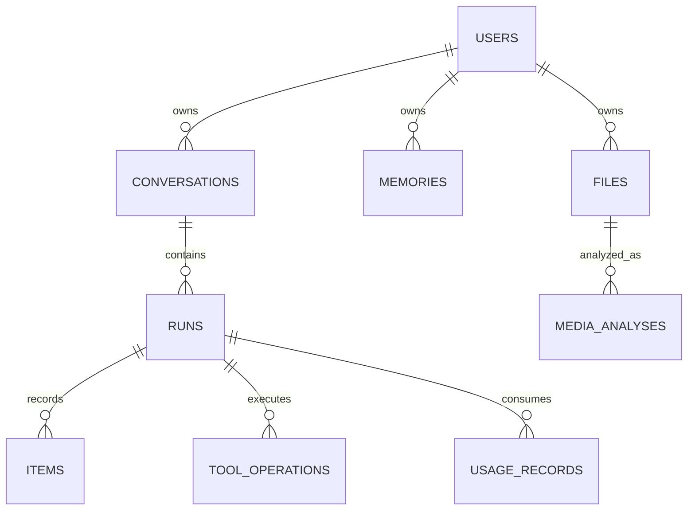

# 12｜数据库设计与 JSON 字段映射

## 12.1 先确定“谁是事实来源”

参考模式以有序 item 日志作为会话内容的事实来源，以运行记录保存生命周期和元数据。不要既在 messages 表维护一份聊天，再在 response JSON 维护另一份可独立修改的聊天而不定义一致性规则。

持久化的目的包括用户刷新后能看历史、任务恢复、故障审计、幂等与成本核算。它不必等于把每个 SSE token 写数据库。写入频率与可恢复精度是需要选择的权衡。

## 12.2 一个通用教学模型

下面是推荐的最小关系，不是生产迁移文件：



| 表/对象 | 核心字段 | 原因 |
|---|---|---|
| users | id、身份映射、状态 | 不把邀请码当永久用户 |
| conversations | id、owner_id、workspace_id、标题、版本 | 会话归属和并发范围 |
| runs | id、conversation_id、parent_run_id、status、原因、时间、metadata | 一次执行生命周期 |
| items | run_id、idx、type、role、payload | 原始输入/调用/结果的顺序日志 |
| tool_operations | operation_id、call_id、参数指纹、状态、外部ID | 业务副作用及重试追踪 |
| usage_records | run_id、attempt_id、计量类型、数量、成本来源 | 每次消耗可核算 |
| memories | owner_id、内容、来源、状态、过期时间 | 跨会话协作信息 |
| files | file_id、owner_id、storage_key、mime、size、hash | 稳定文件身份 |
| media_analyses | file_id、问题范围、版本、证据、状态 | 可复用视觉产物 |

不一定一次建全。只做只读研究可以先不建发布操作账本；但涉及外部写操作，就必须解决未知副作用和幂等。

## 12.3 关键约束示例

```sql
-- 教学片段：省略外键完整定义、迁移与访问策略
CREATE TABLE items (
  run_id uuid NOT NULL,
  idx integer NOT NULL CHECK (idx >= 0),
  item_type text NOT NULL,
  role text,
  payload jsonb NOT NULL,
  PRIMARY KEY (run_id, idx)
);

CREATE UNIQUE INDEX one_active_run_per_conversation
ON runs(conversation_id) WHERE status = 'in_progress';

CREATE UNIQUE INDEX unique_request_per_owner
ON request_keys(owner_id, idempotency_key);
```

唯一约束表达业务不变量，不只是提高查询性能。如果允许同一会话分支并行，唯一约束应按分支范围，而不是照抄这段 SQL。

payload 用 JSON 便于兼容不同 item，但频繁筛选、关联、排序的字段应有明确列与索引。不要所有东西都塞 metadata，然后对海量 JSON 做无索引扫描。

## 12.4 JSON 与数据库怎么对应

前文的 user item → items 一行，item_type=message，role=user。assistant function_call → 一行 function_call，payload 里有 name、arguments、call_id。工具结果 → 一行 function_call_output，payload.call_id 指回调用。最终 assistant message → 另一行。

run.status=completed 表示一次运行终态；function_call 的局部 status 表示调用记录阶段；tool_operations.status 表示外部动作状态。这些字段不应随便同名互抄。

客户端调试 JSON 常是多个来源拼出的视图：历史 item、模型参数、工具说明、记忆、运行元数据。看见 JSON 中某字段不代表它一定有独立数据库列。

## 12.5 索引、分页与历史分支

常见访问路径：按 owner 列会话；按 conversation 找最新运行；按 run_id、idx 顺序读 item；按 operation_id 查写操作；按状态和到期时间扫描任务。

分页优先稳定游标，例如 created_at + id，或连续序号。只用 offset 在新消息不断插入时可能重复/漏项。排序需要稳定的并列规则。

parent_run_id 表示继续关系，可能形成分支。历史加载应沿被选中分支解析，不能把同一会话下所有运行按时间混在一起。如果产品只允许线性会话，也需明确客户端过时 parent 的处理。

## 12.6 终态事务与迟到结果

参考模式在终态事务中锁定运行行，检查是否已终态，并一起处理 item、摘要、费用与关联任务。这样避免“页面完成了但缺最后工具结果”或“摘要已保存而运行仍在处理中”。

推荐保持：同一运行只提交一次终态；已终态后的迟到 worker 不得覆盖；费用记录用稳定事件标识去重；取消与完成的胜者由受控事务决定，而不是最后一个 HTTP 回包覆盖状态。

数据库提交成功不代表 SSE 一定送达，SSE 送达也不代表客户端保存。最终读取接口才是恢复用户可见结果的可靠入口。

## 12.7 迁移、保留和删除

旧库迁移测试是：先构造旧版 schema 和有代表性的历史数据，再运行新迁移，确认旧记录可读、新字段默认正确、约束不误杀旧数据。新空库建表成功不能证明升级安全。

删除会话要考虑历史、附件、摘要、向量、任务、缓存与审计保留。不要用级联删除把仍被其他会话引用的文件直接抹掉。对象存储与数据库的清理可异步，但要能对账孤儿对象。

需要恢复证据或审计时，可先逻辑删除再按策略物理清理；敏感数据删除要求则需明确覆盖备份和派生数据。不要承诺即时彻底删除却只隐藏前端。

## 12.8 面试与练习

问：工具表一定要单独建吗？  
答：只读且只需会话回放，调用/结果 item 可能足够；需要重试、外部副作用、查询进度、计费归因和跨运行追踪时，独立 operation 记录更合适。不是所有 tool call 都需要单独一张表，但一个业务动作不能只靠聊天文本记账。

问：为什么不能直接保存供应商整个 response？  
答：可作为原始审计补充，但它不是稳定领域模型，包含不必要大字段与敏感信息，而且生命周期、权限和查询需求不同。应有内部契约与受控原始证据引用。

练习：有工具结果，但对应调用存储失败。应该回填一条成功调用吗？  
解答：不能伪造模型提议。应依据已有执行审计修复或明确残缺，并在模型视图中构建合法、标记过来源的恢复信息。根因通常是边界不原子或分步写入，需修事务与恢复策略。

